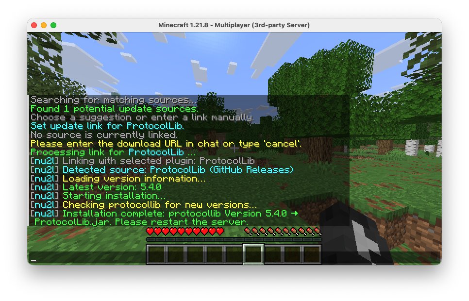
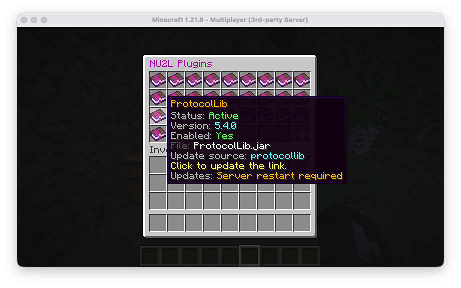
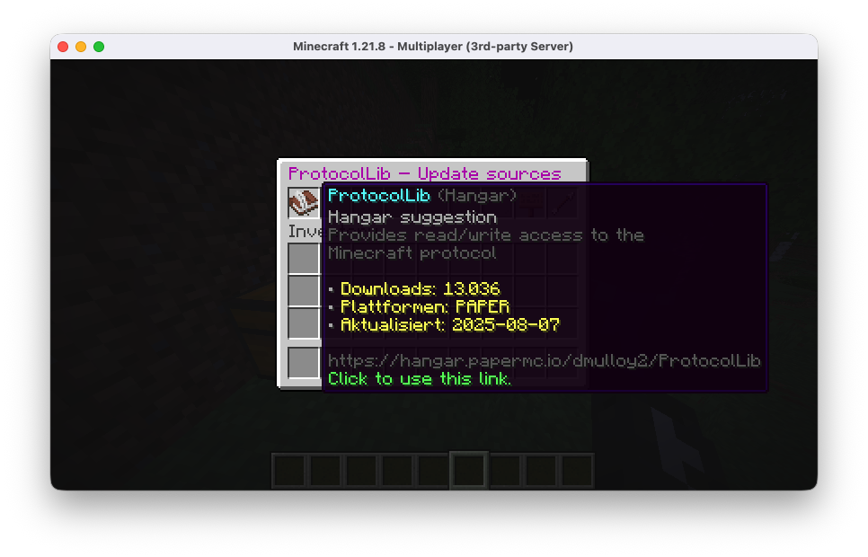
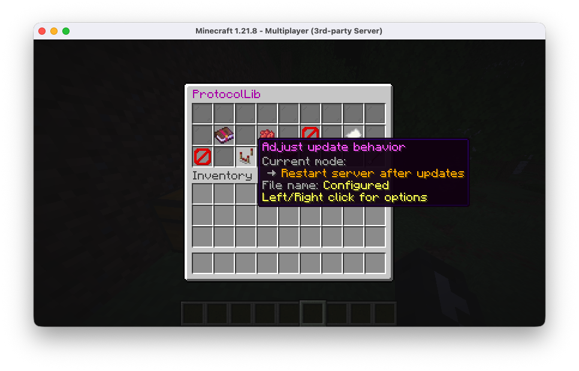
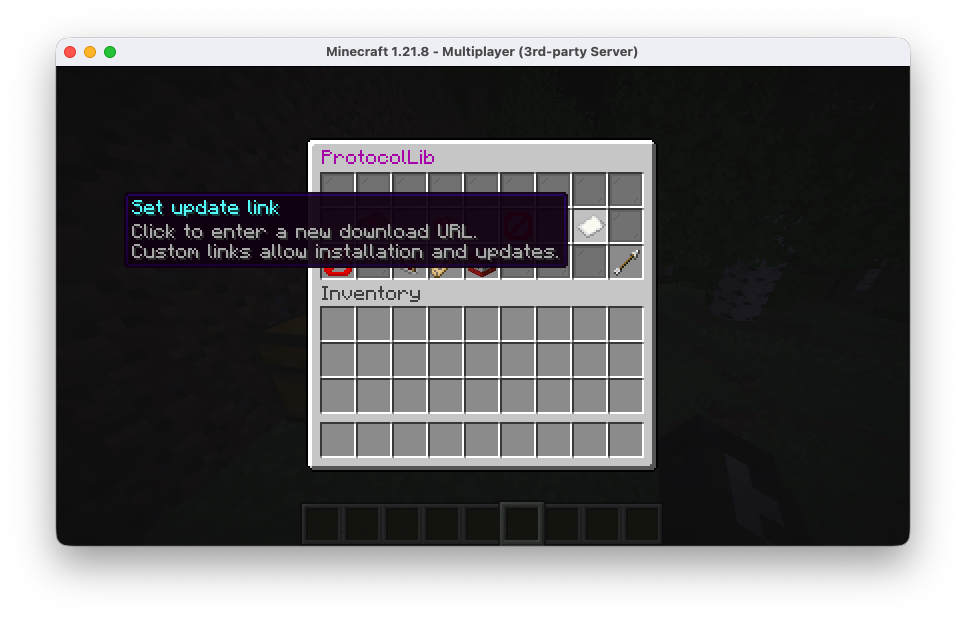

<p align="center">
  <a href="https://github.com/nurkert/never-up-2-late/releases/latest"></a>
  <a href="https://github.com/nurkert/never-up-2-late/releases"></a>
  <a href="https://github.com/nurkert/never-up-2-late/actions/workflows/ci.yml"></a>
  
  
  
</p>

<h3 align="center">Your server and every plugin on it, always up to date, without you lifting a finger.</h3>

NeverUp2Late watches Paper and your plugins on Hangar, Modrinth, CurseForge, SpigotMC, GitHub and Jenkins.
When something new comes out, it downloads it, checks that it is the real file and that your server can run it,
swaps it in, and restarts at night once nobody is online. If an update does not start, it puts the old version back.

```
/nu2l https://modrinth.com/plugin/luckperms
```

That is the whole setup for a new plugin. Paste a link and NeverUp2Late handles the rest, today and for every future release.

---

## Quickstart

1. Download `NeverUp2Late.jar` from the [latest release](https://github.com/nurkert/never-up-2-late/releases/latest) and drop it into `plugins/`.
2. Start the server. Operators get a short setup wizard in-game; on a console-only server run `/nu2l setup complete`.
3. Add plugins by link with `/nu2l <url>`, or open the GUI with `/nu2l` and link the plugins you already have.

Done. NeverUp2Late checks every three hours and keeps itself up to date as well.

**Requirements:** Paper 1.21 or newer (or any server implementing the Bukkit API 1.21+) on Java 21.

## Built to be trusted

An updater that replaces files on a live server has to be more careful than you would be by hand. Every update passes
through these checks, and any one of them can stop it, leaving the installed version untouched:

| | What happens |
|---|---|
| **Checksum verified** | The download is compared against the SHA hash the platform publishes (Paper, Hangar, Modrinth, CurseForge, GitHub). A corrupted or tampered file never reaches your plugins folder. |
| **Right plugin, right place** | The `plugin.yml` inside the jar must match the plugin it replaces. NeverUp2Late never overwrites another plugin's jar and never leaves two copies of one plugin behind. |
| **Will it load?** | Before installing, NeverUp2Late checks that the new version supports your Minecraft version, was built for your Java version, and does not need a plugin you have not installed. |
| **Backup first** | The previous jar is kept (5 per plugin by default). No backup, no install. |
| **Automatic rollback** | After the restart, NeverUp2Late checks that every updated plugin actually started. If one did not, the previous version goes back in, and the broken release is not installed again. |
| **Nobody gets kicked** | Plugin updates restart the server only when it is empty and between 03:00 and 06:00, with a one-hour cooldown. Admins online are told what is waiting. |
| **Stays on your Minecraft version** | Paper is only updated within the version you run. A jump to a new Minecraft release is your decision (`allowGameVersionUpgrade`). |
| **Works on Windows too** | A running jar is locked on Windows, so the update is placed in Bukkit's `update/` folder and the server swaps it in on the next start. |

Want to see what would happen before anything changes? `/nu2l plan` reports every update it would install and every one
it would refuse, without downloading or writing a single file.

## Supported platforms

| Platform | Add it with | Notes |
|---|---|---|
| **Paper** | preconfigured | Server jar; stays on your Minecraft version unless you allow upgrades. |
| **Geyser** | preconfigured | Off by default, switch it on in the wizard or `config.yml`. |
| **Hangar** | `/nu2l <hangar link>` | Prefers pinned and reviewed versions. |
| **Modrinth** | `/nu2l <modrinth link>` | Filters by loader and Minecraft version. |
| **CurseForge** | `/nu2l <curseforge link>` | Optional API key for higher rate limits. |
| **SpigotMC** | `/nu2l <spigotmc link>` | Through the Spiget API. Premium resources cannot be downloaded. |
| **GitHub Releases** | `/nu2l <github link>` | Picks the jar automatically, or asks once if a release has several. Extracts jars from ZIP archives. |
| **Jenkins** | `/nu2l <jenkins job link>` | Last successful build, artifact by pattern. |
| **Anything else** | custom `UpdateFetcher` class | Set `type` to its fully qualified class name. |

## In-game

### Paste a link, pick a file, done



When a release ships several jars or a ZIP, NeverUp2Late lists them in chat. Click the one you want; the choice is
remembered for every future update.

### A GUI for everything else

`/nu2l` opens a chest interface with every plugin on the server. Link plugins to update sources (with suggestions from
Modrinth and Hangar), turn updates on or off per plugin, choose between restart and hot-reload, rename files, or start a
search.



<details>
<summary>More screenshots</summary>







</details>

## Commands

| Command | What it does | Permission |
|---|---|---|
| `/nu2l` | Opens the GUI. | `neverup2late.gui.open` |
| `/nu2l <url>` | Adds the plugin behind a link and installs it. | `neverup2late.install` |
| `/nu2l status` | Lists every update source with its file, version and auto-update state. | `neverup2late.install` |
| `/nu2l plan [source]` | Shows what an update run would install or refuse. Changes nothing. | `neverup2late.install` |
| `/nu2l check [source]` | Looks for updates right now and installs what is newer. | `neverup2late.install` |
| `/nu2l rollback <source>` | Puts the previous version of a plugin back. | `neverup2late.install` |
| `/nu2l remove <name>` | Stops managing a plugin. | `neverup2late.gui.manage.remove` |
| `/nu2l select <number>` | Picks a file when a release offers several (clicking in chat does the same). | `neverup2late.install` |
| `/nu2l ignore` / `cancel` | Installs anyway, or aborts, when a plugin does not list your Minecraft version. | `neverup2late.install` |
| `/nu2l setup` | Opens the setup wizard. | `neverup2late.setup` |
| `/nu2l setup complete` | Finishes setup with the defaults, also from the console. | `neverup2late.setup` |
| `/nu2l setup apply <file>` | Loads update sources from a prepared YAML file and finishes setup. | `neverup2late.setup` |

All permissions default to operators.

<details>
<summary>All permissions</summary>

```
neverup2late.setup                 # Setup wizard
neverup2late.install               # /nu2l <url>, status, plan, check, rollback, select
neverup2late.gui.open              # Open the GUI
neverup2late.gui.manage            # All of the following
neverup2late.gui.manage.lifecycle  # Load, unload, enable plugins
neverup2late.gui.manage.link       # Link plugins with update sources
neverup2late.gui.manage.settings   # Per-plugin update settings
neverup2late.gui.manage.rename     # Rename plugin files
neverup2late.gui.manage.remove     # Remove plugins
```

The command itself has no permission on purpose: moderators with only `neverup2late.gui.open` can still open the GUI.

</details>

## Configuration

Everything lives in `plugins/NeverUp2Late/config.yml`, and the file explains each setting in place. The ones you are most
likely to touch:

| Setting | Default | Meaning |
|---|---|---|
| `updateInterval` | `180` | Minutes between update checks. |
| `startupDelaySeconds` | `60` | Wait after server start before the first check. |
| `backups.maxCount` | `5` | Backups kept per plugin; `0` keeps all. |
| `updates.ignoreUnstable` | `true` | Prefer stable releases over betas. |
| `updates.respectManualRollback` | `true` | Do not reinstall a version you (or the automatic rollback) rolled back from. |
| `pluginLifecycle.autoManage` | `true` | Enables load/unload in the GUI and hot-reload for plugins set to `AUTO_RELOAD`. |
| `quickInstall.ignoreCompatibilityWarnings` | `false` | Install even when a plugin does not list your Minecraft version. |
| `setup.skipWizard` | `false` | Skip the wizard on fresh installs and start updating right away. |

New settings from later versions are added to your file automatically; values you set are never changed.

<details>
<summary>Update sources in config.yml</summary>

`/nu2l <url>` writes these for you, but you can also edit them by hand:

```yaml
updates:
  sources:
    - name: luckperms
      type: modrinth
      target: plugins            # or "server" for the server jar
      filename: "LuckPerms.jar"
      options:
        project: luckperms
        installedPlugin: LuckPerms
```

| Type | Notable `options` |
|------|-------------------|
| `paper` | No fields required; detects the installed Minecraft version. `ignoreUnstable` / `allowUnstable`, `minimumUnstableBuild` (default `50`), `allowGameVersionUpgrade` (default `false`). |
| `geyser` | Preconfigured; usually needs nothing. |
| `hangar` | `owner` + `slug` (or `project: owner/slug`). Optional: `platform`, `allowedChannels`, `ignoreUnstable` / `allowUnstable`, `requireReviewed`, `preferPinned`, `pageSize`, `maxPages`, `installedPlugin`. |
| `modrinth` | `project`. Optional: `loaders`, `statuses`, `versionTypes`, `gameVersions`, `preferPrimaryFile`, `installedPlugin`. |
| `curseforge` | `modId`. Optional: `apiKey`, release type filters, game versions, `installedPlugin`. |
| `spigot` | `resourceId`. Optional: `preferredGameVersions`, `ignoreCompatibilityWarnings`, `installedPlugin`. |
| `githubRelease` | `owner`, `repository`. Optional: `assetPattern`, `allowPrerelease`, `archiveEntryPattern`, `installedPlugin`. |
| `jenkins` | `baseUrl`, `job`. Optional: `artifact`, `artifactPattern`, `preferLastSuccessful`, `versionSource`, `versionPattern`, `installedPlugin`. |
| custom class | `type` is the fully qualified class name of your `UpdateFetcher`; all `options` are passed to its constructor. |

</details>

<details>
<summary>Per-plugin settings (plugin-settings.yml)</summary>

Written by the GUI, one entry per plugin:

- `autoUpdate` – check this plugin on the schedule. Manual checks always work.
- `behaviour` – `REQUIRE_RESTART` (default, the safe choice) or `AUTO_RELOAD` to hot-reload right after the update.
- `retainUpstreamFilename` – keep the file name the platform uses instead of the configured one.

</details>

<details>
<summary>Files NeverUp2Late keeps</summary>

All under `plugins/NeverUp2Late/`:

- `plugins.yml` – the installed version per source, so nothing is downloaded twice.
- `plugin-settings.yml` – per-plugin preferences from the GUI.
- `setup-state.yml` – how far the setup wizard got.
- `restart-state.yml` – time of the last automatic restart, for the cooldown.
- `pending-verification.yml` – updates that still have to prove they start.
- `config-upgrade.yml` – which config upgrades were applied.
- `backups/` – previous versions of replaced jars.

</details>

## FAQ

**Will it restart my server while people are playing?**
No. Plugin updates wait until the server is empty and it is between 03:00 and 06:00. Admins who are online get a chat
message with the version and a link to the changelog.

**What if an update breaks a plugin?**
If the plugin fails to start, NeverUp2Late restores the previous version on its own and does not install that release
again. You can also roll back by hand with `/nu2l rollback <source>` at any time.

**Can I see what it is going to do first?**
`/nu2l plan` lists every update it would install and every one it would refuse, and changes nothing.

**I only want some plugins updated automatically.**
Turn auto-updates off per plugin in the GUI. Manual `/nu2l check <source>` still works for those.

**How does NeverUp2Late update itself?**
From this repository's GitHub releases. Every release first sits as a pre-release for 24 hours, which no installation
downloads, so a broken build can be pulled before it reaches any server.

## Troubleshooting

- Set the log level to `FINE` to see every fetch, decision and lifecycle step.
- If a release has several files and the wrong one is picked, set `assetPattern` or `archiveEntryPattern` for that source.
- Prefer to restart by hand? Set `pluginLifecycle.autoManage: false` and leave every plugin on `REQUIRE_RESTART`.

## License

NeverUp2Late is released under the GNU General Public License v3.0.
